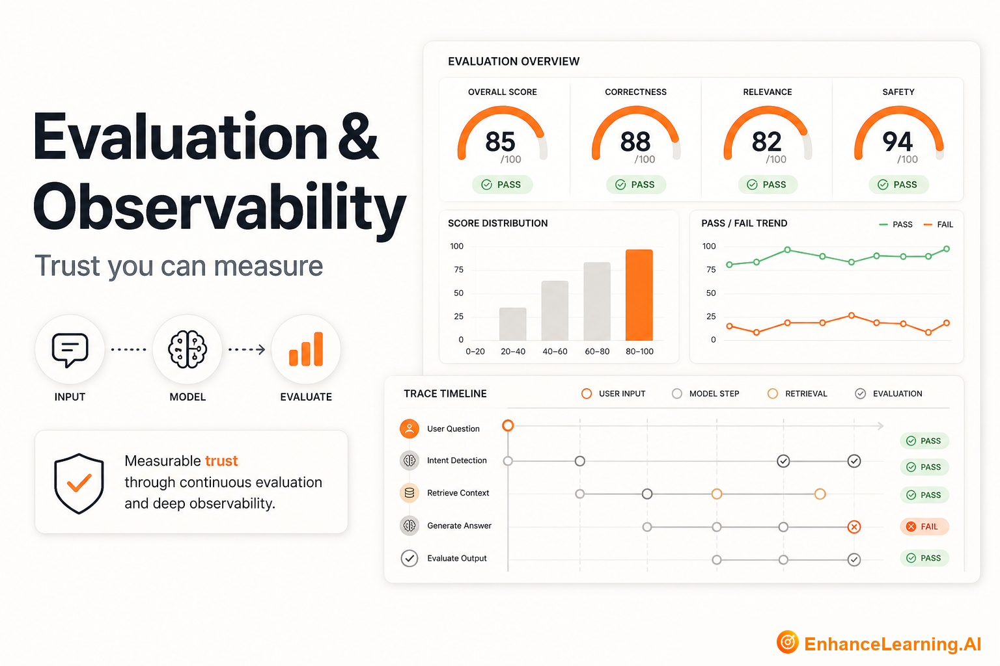

  

# Evaluation & Observability: Trust You Can Measure in AI-Native Systems

> Maintained reading path from [EnhanceLearning.AI](https://enhancelearning.ai) — practitioner-grade articles for engineers, architects, and technology leaders building production AI-native systems.

**Topic on the site:** [Evaluation & Observability](https://enhancelearning.ai/articles?category=Evaluation+%26+Observability) · **Full library:** [enhancelearning.ai/articles](https://enhancelearning.ai/articles)

## What this repo is

A curated reading path for **Evaluation & Observability**. It is not a code SDK — it points to the foundation deep-dives on [EnhanceLearning.AI](https://enhancelearning.ai) so you can align on concepts, critique designs, and ship production systems that hold up.

This topic covers why evals are foundational, lifecycle evaluation, point-in-time vs continuous evals, reproducibility, versioning eval frameworks, and how evaluation differs from observability.

## Who it's for

AI engineers, QA partners, and platform teams owning release quality.

## Foundation articles

- [Why Evals Are the Foundation of Trustworthy AI-Native Systems](https://enhancelearning.ai/articles/why-evals-are-the-foundation-of-trustworthy-ai-native-systems) — Probabilistic AI cannot earn enterprise trust without evaluation. Why evals are the prerequisite for shipping, scaling, and defending AI-native systems.
- [Model Benchmarks vs AI System Evals](https://enhancelearning.ai/articles/model-benchmarks-vs-ai-system-evals) — Leaderboard scores measure model capability in isolation. System evals measure your composed application. Know which layer answers which decision.
- [AI Evaluation vs AI Observability: Scores Aren’t Traces](https://enhancelearning.ai/articles/ai-evaluation-vs-ai-observability) — Evals measure whether quality meets bar. Observability explains why behavior changed. Conflating them leaves teams blind to both regressions and root causes.
- [How to Evaluate AI Systems in Production](https://enhancelearning.ai/articles/how-to-evaluate-ai-systems-in-production) — A practical eval stack for production AI: golden sets, trajectory checks, LLM-as-judge pitfalls, online sampling, and regression gates that block bad releases.
- [Why AI Evaluation Must Run at Every Lifecycle Stage](https://enhancelearning.ai/articles/why-ai-evaluation-must-run-at-every-lifecycle-stage) — Pre-launch gates are not enough. Evaluation belongs at design, build, staging, production, and post-incident — each stage catches failures the others miss.
- [Point-in-Time Evals vs Continuous Evals in AI-Native Systems](https://enhancelearning.ai/articles/point-in-time-evals-vs-continuous-evals-in-ai-native-systems) — Snapshot golden runs catch regressions at release. Continuous sampling catches drift in production. You need both modes — they answer different questions.
- [Why AI Eval Frameworks Need Versioning Just Like Code](https://enhancelearning.ai/articles/why-ai-eval-frameworks-need-versioning-just-like-code) — Unversioned eval logic, datasets, and judge prompts make regression analysis unreliable. Treat eval artifacts as managed code with semver and changelogs.
- [Why Reproducibility Matters in AI Evaluation Pipelines](https://enhancelearning.ai/articles/why-reproducibility-matters-in-ai-evaluation-pipelines) — Eval results you cannot replay are opinions. Seed control, environment pinning, and auditable artifacts make evaluation pipelines trustworthy.

## More from EnhanceLearning.AI

- Homepage: [https://enhancelearning.ai](https://enhancelearning.ai)
- All articles: [https://enhancelearning.ai/articles](https://enhancelearning.ai/articles)
- This topic filter: [Evaluation & Observability](https://enhancelearning.ai/articles?category=Evaluation+%26+Observability)
